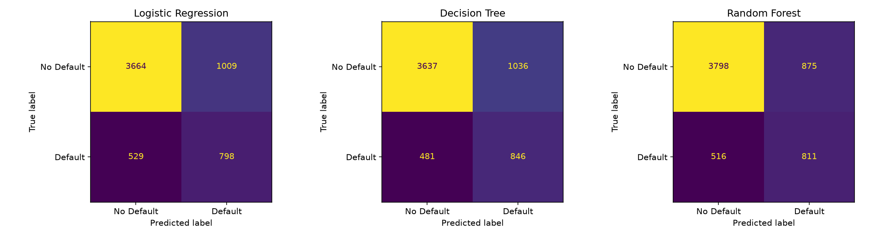
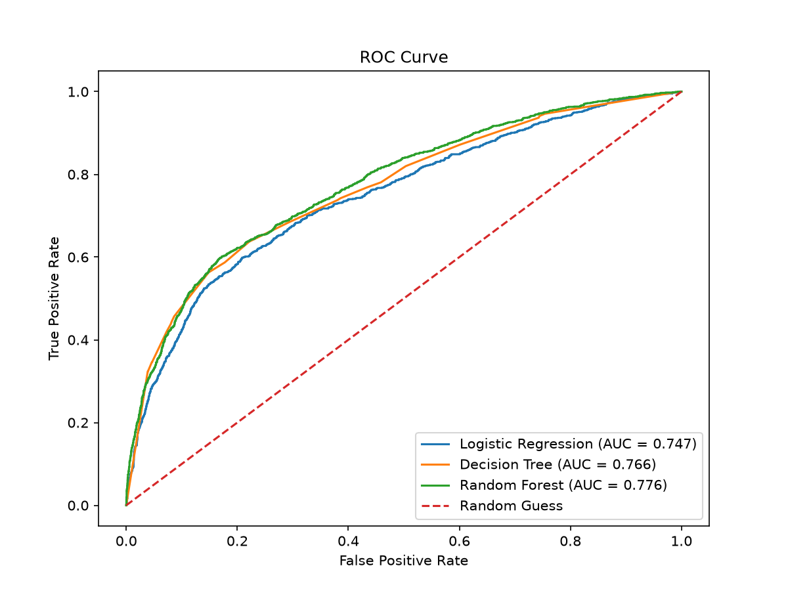
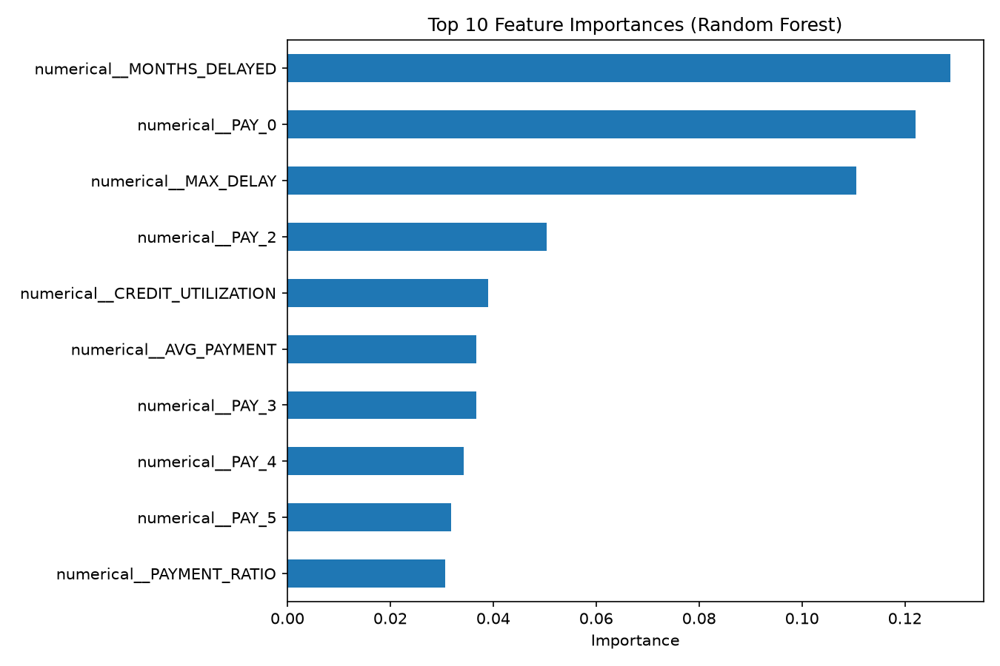

# Credit Scoring Model

**CodeAlpha Machine Learning Internship – Task 1**

## Objective

Predict whether a credit card customer will **default on their payment next month**, using their past financial data. This helps a lender judge a person's creditworthiness before approving credit.

## Dataset

- **Source:** UCI Machine Learning Repository – *Default of Credit Card Clients*
- **Size:** 30,000 customers, 23 input features, 1 target
- **Target:** `default payment next month` (1 = default, 0 = no default)
- **Class balance:** 77.9% no default, 22.1% default (imbalanced)
- **Features include:** credit limit, age, sex, education, marriage status, 6 months of repayment status (`PAY_*`), bill amounts (`BILL_AMT*`) and payment amounts (`PAY_AMT*`)

## Approach

1. **Data loading and inspection:** checked shape, missing values (none) and class balance.
2. **Cleaning:** grouped undocumented values in `EDUCATION` (0, 5, 6) and `MARRIAGE` (0) into "others".
3. **Feature engineering** from financial history:
   | Feature | Meaning |
   |---|---|
   | `AVG_BILL` | Average bill over 6 months |
   | `AVG_PAYMENT` | Average payment over 6 months |
   | `PAYMENT_RATIO` | Total paid / total billed |
   | `CREDIT_UTILIZATION` | Average bill / credit limit |
   | `MAX_DELAY` | Worst payment delay in 6 months |
   | `MONTHS_DELAYED` | Number of months with a delayed payment |
4. **Preprocessing:** One-Hot Encoding for categorical columns, Standard Scaling for numerical columns (fitted on training data only, to avoid data leakage).
5. **Train/test split:** 80/20, stratified so both sets keep the same default rate.
6. **Models:** Logistic Regression, Decision Tree (max depth 5), Random Forest (200 trees, max depth 10). All use `class_weight="balanced"` to handle the class imbalance.
7. **Evaluation:** Accuracy, Precision, Recall, F1-Score, ROC-AUC, confusion matrices and ROC curves.

## Results

| Model | Accuracy | Precision | Recall | F1 Score | ROC-AUC |
|---|---|---|---|---|---|
| Logistic Regression | 0.7437 | 0.4416 | 0.6014 | 0.5093 | 0.7473 |
| Decision Tree | 0.7472 | 0.4495 | 0.6375 | 0.5273 | 0.7657 |
| **Random Forest** | **0.7682** | **0.4810** | 0.6112 | **0.5383** | **0.7758** |

### Confusion matrices (test set, 6,000 customers)

| Model | True Negative | False Positive | False Negative | True Positive |
|---|---|---|---|---|
| Logistic Regression | 3664 | 1009 | 529 | 798 |
| Decision Tree | 3637 | 1036 | 481 | 846 |
| Random Forest | 3798 | 875 | 516 | 811 |





## Conclusion

**Random Forest performed best**, with the highest ROC-AUC (0.776), F1 score (0.538), accuracy and precision. It can catch about 61% of real defaulters while keeping false alarms lower than the other two models.

Points worth noting:

- Because only ~22% of customers default, plain accuracy is misleading (a model that always says "no default" would get ~78%). That is why Recall, F1 and ROC-AUC are used to judge the models.
- In credit scoring, missing a real defaulter (false negative) is usually more costly than wrongly flagging a good customer, so **Recall** is important. The Decision Tree has the highest recall (0.6375), but the Random Forest gives the best overall balance.
- The three most important features were `MONTHS_DELAYED` (0.129), `PAY_0` (0.122) and `MAX_DELAY` (0.111). Two of these are engineered features, so the feature engineering improved the model. Payment delay behaviour is by far the strongest signal of default, followed by `PAY_2` and `CREDIT_UTILIZATION`.

## How to Run

```bash
git clone https://github.com/Simrangit0403/CodeAlpha_CreditScoring.git
cd CodeAlpha_CreditScoring
pip install -r requirements.txt
python credit_scoring.py
```

Make sure the dataset file `default of credit card clients.xls` is inside the `data/` folder.

## Project Structure

```
CodeAlpha_CreditScoring/
├── data/
│   └── default of credit card clients.xls
├── credit_scoring.py
├── model_comparison.csv
├── confusion_matrices.png
├── roc_curve.png
├── feature_importance.png
├── requirements.txt
└── README.md
```

## Tech Stack

Python, Pandas, Scikit-learn, Matplotlib, Joblib

## Possible Improvements

- Hyperparameter tuning with `GridSearchCV`
- Try Gradient Boosting or XGBoost
- Adjust the decision threshold to prioritise recall
- Handle imbalance with SMOTE

---

*Built as part of the CodeAlpha Machine Learning Internship.*